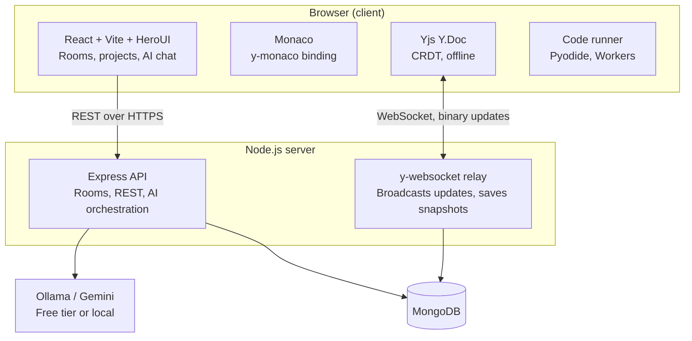

# OctoCode

**Real-time collaborative coding with CRDTs and an AI pair programmer.**

Multiple people edit the same code at the same time, with no conflicts. Write and run Python, JavaScript, Java, C++ and C, ask the AI for help, and keep editing offline.

---

## Quick start (macOS)

**Prerequisite:** [Docker Desktop](https://www.docker.com/products/docker-desktop/) (`brew install --cask docker`).

```bash
git clone https://github.com/pavankumar-2005/octocode.git && cd octocode
make up
open http://localhost:5173
```

That's it. One command starts the client, server, code runner, and MongoDB.

Prefer clicking? Double-click `start.command` in Finder.

| Command | What it does |
| --- | --- |
| `make up` | Build and start everything |
| `make down` | Stop everything |
| `make logs` | Follow logs |
| `make rebuild` | Rebuild after changing `package.json` |
| `make reset` | Stop and wipe the database |

---

## Why CRDTs

Most student editors broadcast raw text over WebSockets, so two people typing in the same spot can silently corrupt the document. Operational Transformation fixes this but needs a central coordinator. OctoCode uses **CRDTs (Yjs)**: every client converges to the same document regardless of update order, and offline edits merge cleanly.

## Features

- **Live collaboration:** shared rooms, named cursors, conflict-free merging
- **Monaco Editor:** the VS Code editor core
- **Run code in 5 languages:** Python (Pyodide) and JavaScript in browser Web Workers; Java, C++ and C in a sandboxed runner container (no internet, resource limits). All with a 10 s timeout
- **AI assistant:** explain code, suggest fixes, pair-program (Ollama locally, or Gemini free tier)
- **Offline-first:** keep typing without internet; changes sync on reconnect
- **Two ways to work:** *quick sessions* (no account, deleted after 24 h) and *long-term projects* (sign in, kept, members only, project dashboard)
- **Accounts:** email + password, stored safely in MongoDB (salted `scrypt` hashes)
- **Light and dark theme**, full-screen editor layout
- **Persistent projects:** MongoDB stores room data and document state

## Architecture



Details: [docs/architecture.md](docs/architecture.md)

## Tech stack

| Layer | Tech |
| --- | --- |
| Frontend | React, Vite, TypeScript, HeroUI, Tailwind CSS v4 |
| Editor and sync | Monaco, Yjs, y-monaco, y-websocket, y-indexeddb |
| Backend | Node.js, Express, ws |
| Database | MongoDB |
| Run code | Pyodide + Web Workers (Python, JS); runner container with gcc, g++, OpenJDK 17 (C, C++, Java) |
| AI | Ollama or Gemini |
| Infra | Docker Compose |

## Project structure

```text
octocode/
├── client/          React + HeroUI app
├── server/          Express API + Yjs WebSocket relay
├── runner/          Sandboxed Java / C++ / C compiler + runner
├── docs/            Documentation
├── docker-compose.yml
├── Makefile
└── start.command
```

## Documentation

| Doc | Purpose |
| --- | --- |
| [docs/architecture.md](docs/architecture.md) | How the system works |
| [docs/api.md](docs/api.md) | REST and WebSocket reference |
| [docs/decisions.md](docs/decisions.md) | Why we chose what we chose |
| [docs/changelog.md](docs/changelog.md) | What changed, when |

## Configuration

Copy `.env.example` to `.env` (done automatically by `make up`). Choose the AI provider with `AI_PROVIDER=ollama` or `gemini`.

## License

MIT
