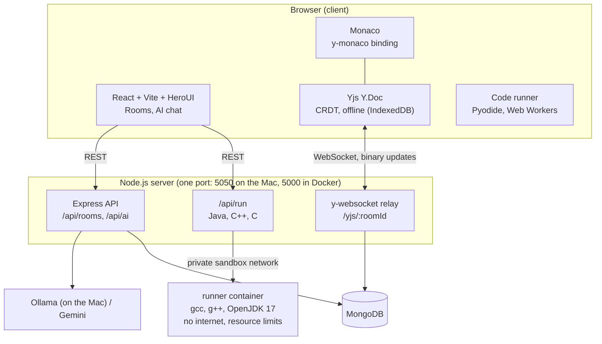

# Architecture

## Overview

## Services and ports

| Service | Port | Runs in |
| --- | --- | --- |
| Client (Vite dev server) | 5173 | Docker container |
| Server (REST + WebSocket) | 5050 on the Mac → 5000 in the container | Docker container |
| MongoDB | 27017 | Docker container |
| Runner (Java/C++/C) | 7000, **not published**; only the server can reach it | Docker container, `sandbox` network |
| Ollama (optional) | 11434 | Directly on the Mac (reached via `host.docker.internal`) |

## Data flows

### 1. Typing (the core idea)

1. You type in Monaco.
2. `y-monaco` turns the edit into a change on the shared `Y.Text`.
3. Yjs encodes the change as a small **binary update**.
4. `y-websocket` sends it to the server over the WebSocket.
5. The relay broadcasts it to everyone else in the room.
6. Their `Y.Doc` applies the update (CRDT merge) and `y-monaco` updates their editor.

Because updates merge in any order, two people typing in the same spot still end up with identical text.

### 2. Persistence

- First client opens a room → server loads the saved state from MongoDB (`yjs_docs`) into the in-memory doc.
- Every update → debounced (1 s) save of the full state.
- Last client leaves → final save.
- The client caches room info (`name`, `language`) in `localStorage`, so a room opens even when the server is down.

### 3. Offline

- `y-indexeddb` stores the doc in the browser.
- While offline, edits go to IndexedDB only.
- On reconnect, `y-websocket` exchanges missing updates with the server. Both sides merge.

### 4. Run code

Python and JavaScript run in the browser. Java, C++ and C run in the `runner` container.

- Python: `python-worker.js` loads Pyodide (Python compiled to WebAssembly) and runs the code.
- JavaScript: `js-worker.js` runs the code with a captured `console`.
- Both run in a Web Worker, so the UI stays responsive. A timeout terminates the worker (stops infinite loops).
- Python/JS runs happen **in the user's own browser**, so they need no server sandbox.
- Java/C++/C: the client sends `{ language, code }` to `POST /api/run`. The server forwards it to the `runner` container over a private Docker network. The runner writes the code into a fresh temp folder, compiles it (`javac` / `g++ -std=c++17` / `gcc`, 15 s limit), runs it (10 s limit, 64 KB output limit), kills the whole process group on timeout, deletes the folder and returns `{ ok, output }`.
- Runner lockdown: no internet (`internal` network), read-only filesystem except a 64 MB in-memory `/tmp`, 512 MB RAM, 1 CPU, 128 processes, no Linux capabilities, non-root user.
- Programs get no stdin (reading input returns end-of-file).

### 5. AI assistant

1. Client sends `{ prompt, code, language }` to `POST /api/ai/chat`.
2. Server picks the provider (`AI_PROVIDER`): Ollama or Gemini.
3. Server returns `{ reply }`. API keys never reach the browser.

## Data model (MongoDB)

| Collection | Document |
| --- | --- |
| `rooms` | `{ _id (8-char id), name, language (python, javascript, java, cpp, c), createdAt }` |
| `yjs_docs` | `{ _id (= room id), update (binary Yjs state), updatedAt }` |

## Code map

| Path | Responsibility |
| --- | --- |
| `server/src/index.js` | Express app, WebSocket upgrade for `/yjs/*` |
| `server/src/db.js` | MongoDB connection |
| `server/src/yjs.js` | Loads y-websocket utils (one shared Yjs copy) + Mongo persistence hooks |
| `server/src/routes/rooms.js` | Create and fetch rooms |
| `server/src/routes/ai.js` | AI provider call |
| `server/src/routes/run.js` | Forwards Java/C++/C runs to the runner |
| `runner/src/run.js` | Compile + run per language, timeouts, output limit, cleanup |
| `runner/src/index.js` | Runner's `POST /run` endpoint |
| `client/src/lib/languages.ts` | Supported languages: label, Monaco id, where it runs, starter code |
| `client/src/lib/collab.ts` | Creates `Y.Doc`, WebSocket provider, IndexedDB persistence |
| `client/src/components/CodeEditor.tsx` | Monaco + `y-monaco` binding |
| `client/src/lib/monaco.ts` | Local Monaco setup (workers, `loader.config`) so `y-monaco` and the editor share one Monaco |
| `client/src/lib/api.ts` | REST calls (rooms, AI) |
| `client/src/lib/user.ts` | Guest name + color in `localStorage` |
| `client/src/lib/runCode.ts` | Picks browser worker or server runner; worker timeout |
| `client/src/pages/Home.tsx` | Create room / join by ID or link |
| `client/src/pages/Room.tsx` | Room layout, presence avatars, remote cursor colors, Run, Copy link |
| `client/src/components/StatusChip.tsx` | Online / Syncing / Offline chip from WebSocket status + `navigator.onLine` |
| `client/src/components/AiChat.tsx` | Chat sidebar + "Explain selection" |
| `client/src/components/OutputPanel.tsx` | Shows run output / errors |
| `client/public/*-worker.js` | Python / JS execution workers |

## Known limits (MVP)

- No authentication; users are guests with a display name.
- Anyone with the room link can edit.
- One language per room (chosen at creation).
- Java/C++/C programs can't read input (no stdin) and run one file only.
- The runner is container-isolated, fine for a demo but not hardened for a public service.
