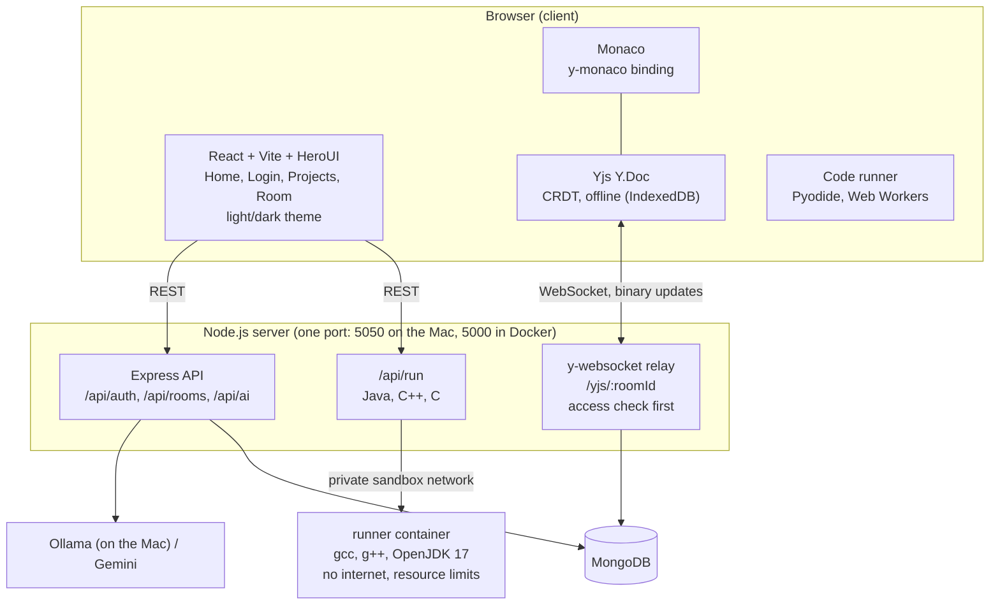

# Architecture

## Overview

## Services and ports

| Service | Port | Runs in |
| --- | --- | --- |
| Client (Vite dev server) | 5173 | Docker container |
| Server (REST + WebSocket) | 5050 on the Mac → 5000 in the container | Docker container |
| MongoDB | 27017 | Docker container |
| Runner (Java/C++/C) | 7000, **not published**; only the server can reach it | Docker container, `sandbox` network |
| Ollama (optional) | 11434 | Directly on the Mac (reached via `host.docker.internal`) |

## Data flows

### 1. Typing (the core idea)

1. You type in Monaco.
2. `y-monaco` turns the edit into a change on the shared `Y.Text`.
3. Yjs encodes the change as a small **binary update**.
4. `y-websocket` sends it to the server over the WebSocket.
5. The relay broadcasts it to everyone else in the room.
6. Their `Y.Doc` applies the update (CRDT merge) and `y-monaco` updates their editor.

Because updates merge in any order, two people typing in the same spot still end up with identical text.

### 1b. Edit log (who changed what, and when)

1. `trackEdits` (`client/src/lib/editLog.ts`) observes the shared `Y.Text`.
2. For each **local** change (`transaction.local`), it reads the change's delta, works out the line range, and appends `{ name, color, from, to, time }` to the shared `Y.Array("editLog")` in the same `Y.Doc`. Remote changes are ignored, because the teammate's browser logs them itself.
3. Typing by the same person on the same or neighbouring lines within 30 s replaces their last entry with a widened one, so the log shows "lines 4–9" rather than one row per keystroke. Only the newest 200 entries are kept.
4. Because the log lives in the `Y.Doc`, it uses the same path as the code: live sync over the WebSocket, offline storage in IndexedDB, and persistence in MongoDB (`yjs_docs`). There's no new endpoint or collection.
5. `EditLog.tsx` renders it under the editor, newest first. Clicking a row jumps the editor to that line.

### 2. Persistence

- First client opens a room → server loads the saved state from MongoDB (`yjs_docs`) into the in-memory doc.
- Every update → debounced (1 s) save of the full state.
- Last client leaves → final save.
- The client caches room info (`name`, `language`) in `localStorage`, so a room opens even when the server is down.

### 3. Offline

- `y-indexeddb` stores the doc in the browser.
- While offline, edits go to IndexedDB only.
- On reconnect, `y-websocket` exchanges missing updates with the server. Both sides merge.

### 4. Run code

Python and JavaScript run in the browser. Java, C++ and C run in the `runner` container.

- Python: `python-worker.js` loads Pyodide (Python compiled to WebAssembly) and runs the code.
- JavaScript: `js-worker.js` runs the code with a captured `console`.
- Both run in a Web Worker, so the UI stays responsive. A timeout terminates the worker (stops infinite loops).
- Python/JS runs happen **in the user's own browser**, so they need no server sandbox.
- Java/C++/C: the client sends `{ language, code }` to `POST /api/run`. The server forwards it to the `runner` container over a private Docker network. The runner writes the code into a fresh temp folder, compiles it (`javac` / `g++ -std=c++17` / `gcc`, 15 s limit), runs it (10 s limit, 64 KB output limit), kills the whole process group on timeout, deletes the folder and returns `{ ok, output }`.
- Runner lockdown: no internet (`internal` network), read-only filesystem except a 64 MB in-memory `/tmp`, 512 MB RAM, 1 CPU, 128 processes, no Linux capabilities, non-root user.
- Programs get no stdin (reading input returns end-of-file).

### 5. Accounts and room access

- Two room kinds: **temporary** (anyone with the link, deleted after 24 h) and **project** (signed-in members only, kept).
- Sign-up / sign-in → server hashes the password with `scrypt` + a per-user salt, creates a random 32-byte token, stores `sha256(token)` in `sessions` (7-day TTL) and returns the token.
- The client keeps the token in `localStorage` and sends `Authorization: Bearer <token>` on every REST call. `attachUser` middleware turns it into `req.user` (or `null`).
- Opening a project: `GET /api/rooms/:id` → `401` without a token. The client redirects to `/login?next=/room/:id` and comes back after sign-in. A signed-in user with the link is added to `members`.
- The WebSocket upgrade runs the same check (`canJoin` in `server/src/index.js`) using `?token=` from the URL, so a project's code can't be read by connecting to `/yjs/<id>` directly.
- Team size (1–6, chosen at creation): a project accepts at most `teamSize` members. The join is a single conditional update (`members.<teamSize-1>` must not exist), so two people can't take the last seat at once. A temporary room accepts at most `teamSize` live WebSocket connections, counted from y-websocket's in-memory `docs` map (`onlineCount` in `server/src/yjs.js`), checked on `GET /api/rooms/:id` and again on the upgrade.
- Past projects: opening a project sets `lastOpenedAt`. `GET /api/rooms` sorts by it, and the Home page shows the three most recent to signed-in users.
- Expiry: `rooms`, `yjs_docs` and `sessions` have TTL indexes on `expiresAt`. A temporary room gets a `yjs_docs` placeholder with the same `expiresAt`, so its code is deleted with it. `findLiveRoom` hides rooms in the up-to-a-minute gap before MongoDB deletes them.

### 6. Theme

- `light` / `dark` class on `<html>`. HeroUI (`hero.ts` brand colors) and Tailwind's `dark:` read it. Monaco switches between the `octo-light` / `octo-dark` themes (`lib/monaco.ts`).
- An inline script in `index.html` sets the class before first paint (saved choice, else the OS preference), so there's no flash. `lib/theme.tsx` toggles it and saves it in `localStorage`.

### 7. AI assistant

1. Client sends `{ prompt, code, language }` to `POST /api/ai/chat`.
2. Server picks the provider (`AI_PROVIDER`): Ollama or Gemini.
3. Server returns `{ reply }`. API keys never reach the browser.

## Data model (MongoDB)

| Collection | Document |
| --- | --- |
| `rooms` | `{ _id (8-char id), name, language (python, javascript, java, cpp, c), kind ("temporary" \| "project"), teamSize (1–6), createdAt, expiresAt? (temporary), ownerId? + members[] + lastOpenedAt? (project) }` |
| `yjs_docs` | `{ _id (= room id), update (binary Yjs state: the code and the edit log), updatedAt, expiresAt? (temporary rooms) }` |
| `users` | `{ _id (12-char id), name, email (unique, lower-case), passwordHash ("salt:scrypt-hash"), createdAt }` |
| `sessions` | `{ _id (sha256 of token), userId, expiresAt }` |

Indexes (created on server start in `db.js`): unique `users.email`; TTL (`expireAfterSeconds: 0`) on `expiresAt` in `rooms`, `yjs_docs`, `sessions`; `rooms.members`.

## Code map

| Path | Responsibility |
| --- | --- |
| `server/src/index.js` | Express app, WebSocket upgrade for `/yjs/*` with the access check |
| `server/src/db.js` | MongoDB connection + indexes |
| `server/src/auth.js` | Password hashing, sessions/tokens, `attachUser` / `requireUser` middleware |
| `server/src/routes/auth.js` | Register, login, me, logout |
| `server/src/yjs.js` | Loads y-websocket utils (one shared Yjs copy) + Mongo persistence hooks |
| `server/src/routes/rooms.js` | Create, fetch, list rooms; temporary vs project rules |
| `server/src/routes/ai.js` | AI provider call |
| `server/src/routes/run.js` | Forwards Java/C++/C runs to the runner |
| `runner/src/run.js` | Compile + run per language, timeouts, output limit, cleanup |
| `runner/src/index.js` | Runner's `POST /run` endpoint |
| `client/src/lib/languages.ts` | Supported languages: label, Monaco id, where it runs, starter code |
| `client/src/lib/collab.ts` | Creates `Y.Doc`, WebSocket provider, IndexedDB persistence |
| `client/src/lib/editLog.ts` | Records the user's own edits (name, lines, time) in the shared `editLog` array |
| `client/src/components/EditLog.tsx` | Small "Edit log" panel under the editor; click a row to jump to the line |
| `client/src/components/CodeEditor.tsx` | Monaco + `y-monaco` binding |
| `client/src/lib/monaco.ts` | Local Monaco setup (workers, `loader.config`) so `y-monaco` and the editor share one Monaco |
| `client/src/lib/api.ts` | REST calls (auth, rooms, AI, run); adds the token header |
| `client/src/lib/auth.tsx` | `AuthProvider` / `useAuth`: current account, sign in/up/out |
| `client/src/lib/theme.tsx` | `ThemeProvider` / `useTheme`: light/dark switch |
| `client/src/lib/user.ts` | Guest name + color in `localStorage` |
| `client/src/lib/runCode.ts` | Picks browser worker or server runner; worker timeout |
| `client/src/pages/Home.tsx` | Landing: past projects (signed in), quick session form + join, long-term project entry |
| `client/src/pages/Login.tsx` | Sign in / create account, `?next=` redirect |
| `client/src/pages/Projects.tsx` | Project dashboard: list, create, open by link |
| `client/src/pages/Room.tsx` | Full-screen room: header, editor + edit log, AI + output, status bar; project login redirect |
| `client/src/components/TeamSizeSelect.tsx` | "Team size" dropdown (Just me … 6 people), used when creating rooms |
| `client/src/components/ProjectTile.tsx` | Project card (members/teamSize, last opened), used on Home and Projects |
| `client/src/components/TopNav.tsx`, `ThemeToggle.tsx`, `Logo.tsx`, `Backdrop.tsx`, `Icons.tsx` | Shared UI pieces |
| `client/src/components/StatusChip.tsx` | Online / Syncing / Offline chip from WebSocket status + `navigator.onLine` |
| `client/src/components/AiChat.tsx` | Chat sidebar + "Explain selection" |
| `client/src/components/OutputPanel.tsx` | Shows run output / errors |
| `client/public/*-worker.js` | Python / JS execution workers |

## Known limits (MVP)

- Quick sessions: no authentication, anyone with the link can edit until expiry.
- Projects: any signed-in user with the link becomes a member. No roles, member removal, project deletion, password reset or email verification.
- An open tab can keep editing a temporary room for a moment after it expires (until it reconnects).
- One language per room (chosen at creation).
- Java/C++/C programs can't read input (no stdin) and run one file only.
- The runner is container-isolated, fine for a demo but not hardened for a public service.
